# Alt Tab Glide

A GNOME Shell extension that keeps GNOME's own Alt+Tab switcher and gives the selected item a rounded highlight in the accent color, in the style of [Fast GNOME Menu](https://github.com/wvmj-dev/fast-gnome-menu)'s buttons. When the selection moves, the highlight **slides**, **stretches**, **flows like a liquid drop**, **springs like jelly**, **pops** or **fades** to the next item, and the selected item grows a little. Each style can be tuned, with a live preview in the preferences.

Everything else is GNOME's switcher, unchanged: the same shortcuts, the same order, the same window thumbnails.

| Default highlight | Liquid, halfway to the next app |
|---|---|
| 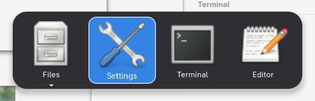 | 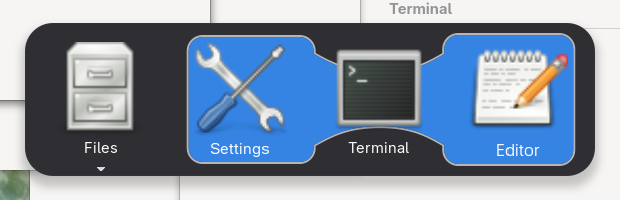 |
| **Jelly, springing past the app** | **Stretch, halfway to the next app** |
| 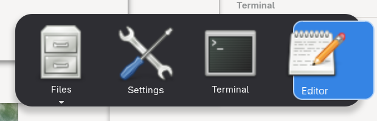 | 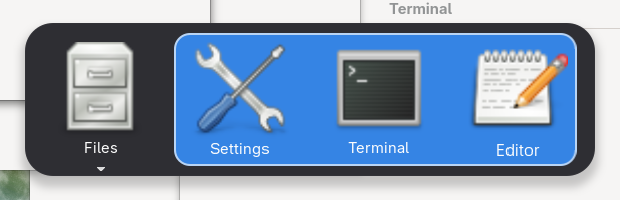 |
| **Custom color, square corners, no border** | **Translucent, with a thick border** |
| 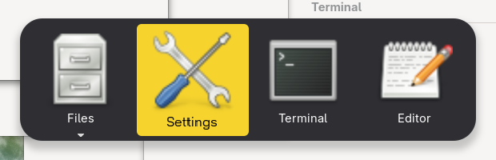 | 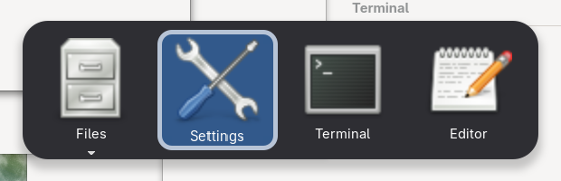 |

| Window thumbnails: outline on the app, highlight on the window | Window switcher (the `switch-windows` shortcut) |
|---|---|
| 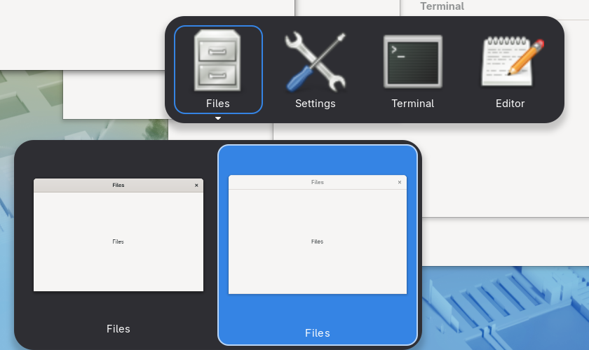 | 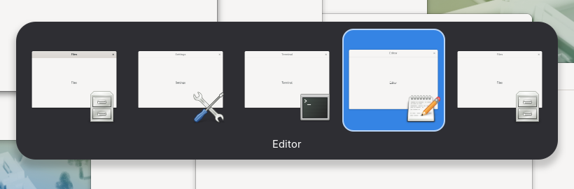 |

| Appearance | Animation, liquid | Animation, jelly |
|---|---|---|
| 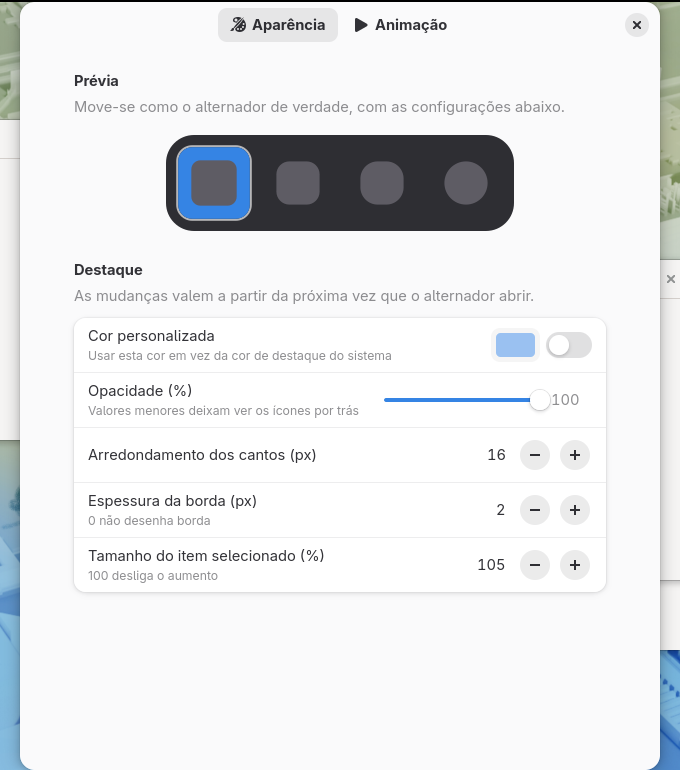 | 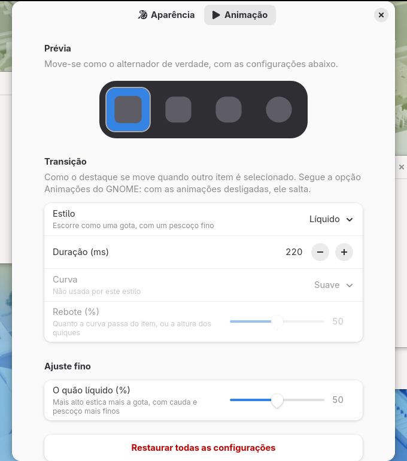 | 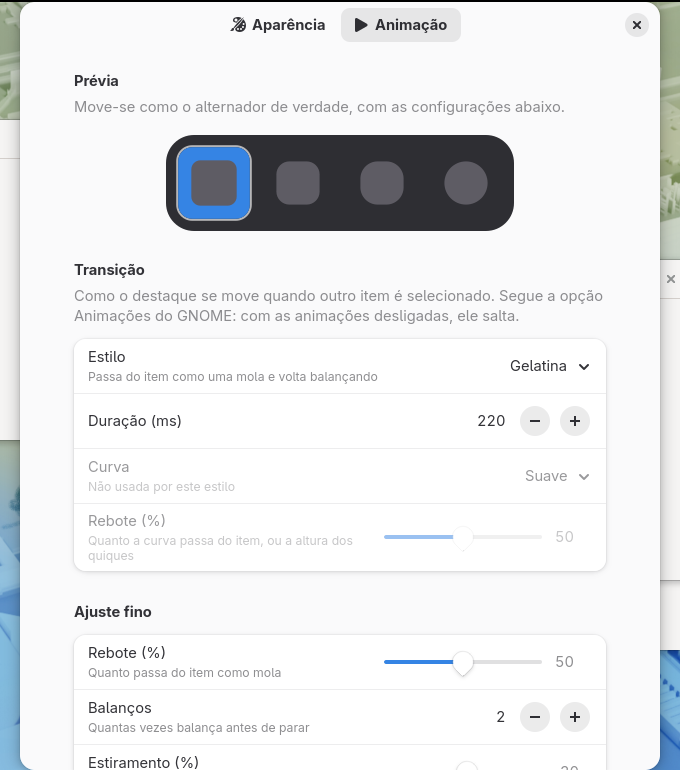 |

The screenshots are taken by the [smoke test](#smoke-test-buildsh-test) in a headless GNOME Shell. The preferences in them are in Brazilian Portuguese, one of the bundled translations.

## Contents

- [Quick start](#quick-start)
- [Features](#features)
- [Requirements](#requirements)
- [Installation](#installation)
- [Usage](#usage)
- [Settings](#settings)
- [How it works](#how-it-works)
- [Performance](#performance)
- [Project layout](#project-layout)
- [Building and packaging](#building-and-packaging)
- [Tests](#tests)
- [Editing the extension](#editing-the-extension)
- [Development and debugging](#development-and-debugging)
- [Translations](#translations)
- [Project status](#project-status)
- [Ideas for later](#ideas-for-later)

## Quick start

On GNOME Shell 48, 49, 50 or 51 (Fedora: `sudo dnf install gnome-shell gjs glib2 gettext`, usually already installed):

```sh
git clone https://github.com/wvmj-dev/alttab-glide.git
cd alttab-glide
./build.sh install
```

1. **Log out and back in** (on Wayland, GNOME only loads new extensions on a new login).
2. Enable it in the **Extensions** app, or with `gnome-extensions enable alttab-glide@wvmj-dev.github.io`.
3. Press **`Alt+Tab`** as usual: the selected item now has the highlight, and it glides to the next one.
4. Open the preferences from the Extensions app, or with `gnome-extensions prefs alttab-glide@wvmj-dev.github.io`, to pick a style (try **Liquid** or **Jelly**), a curve, colors and sizes. The preview at the top shows each change at once; the switcher uses them the next time it opens.

More in [Installation](#installation), [Usage](#usage) and [Settings](#settings).

## Features

- **GNOME's switcher, kept as it is:** no new popup, shortcut or window order. The extension only draws behind the selected item.
- **Highlight:**
  - the system accent color, or any color, with black or white text depending on which reads better;
  - opacity, so the icons behind can show through;
  - corner radius and border width (or no border);
  - the selected item grows a little (up to 115%, or not at all).
- **Transitions** when another item is selected, with the keyboard, the mouse or the scroll wheel:
  - **Slide:** the highlight moves to the next item in one motion;
  - **Stretch:** it reaches out over both items, then lets go of the previous one;
  - **Liquid:** it flows like a drop: the head runs ahead to the next item, the tail follows, thinner, and a bridge between them narrows into a neck;
  - **Jelly:** it springs past the item and wobbles back, stretching along the movement while fast;
  - **Pop:** it shrinks into the previous item and grows out of the next one;
  - **Fade:** it dims out and comes back on the next item;
  - **None:** it jumps.
- **Speed and curves:** duration from 50 ms to 1 s, and five curves for slide, stretch, pop and fade: *smooth*, *overshoot* (goes past and springs back), *bounce* (lands like a dropped ball), *elastic* (swings around the item) and *linear*. The **rebound** of overshoot, bounce and elastic is adjustable.
- **Fine-tuning per style:**
  - liquid: **how liquid** (how far the head runs ahead, how thin the tail and the neck get);
  - jelly: **bounce** (how far past the item), **wobbles** (1 to 4) and **stretch**;
  - pop: how small it **shrinks**;
  - stretch: how long it stays **stretched** over both items.
- **Live preview** at the top of the preferences: a small switcher where the highlight moves in a loop with the current settings, exactly as in the shell.
- **Every switcher:**
  - the app switcher (`Alt+Tab`) and its window thumbnails, where the app keeps an outline while the highlight moves to the window;
  - the window switcher (`switch-windows`);
  - `Ctrl+Alt+Tab` (switching between the top bar, the dash and windows) and the input source switcher (`Super+Space`), which use the same list.
- **Follows GNOME's Animations setting:** with animations off, the highlight jumps.
- **HiDPI:** works with interface scale 2× and up.
- **Lightweight:** nothing runs while the switcher is closed, and the highlight goes away with the switcher. See [Performance](#performance) for measurements.
- **Translations** for Brazilian Portuguese and Spanish.

## Requirements

### To use and build

| Package (Fedora) | Version | Provides | Used for |
|---|---|---|---|
| `gnome-shell` | 48, 49, 50 or 51 | GNOME Shell and the `gnome-extensions` command | Running, enabling and packing the extension |
| `gjs` | the one shipped with GNOME | GNOME's JavaScript interpreter | Running the extension, the preferences and the unit tests |
| `glib2` | any recent | `glib-compile-schemas` | Compiling the settings schema |
| `gettext` | any recent | `msgfmt`, `xgettext`, `msgmerge` | Compiling and updating translations |

`gnome-shell` and `gjs` come with any GNOME installation. The scripts need `bash`.

### To test and develop

| Package (Fedora) | Provides | Used by |
|---|---|---|
| `gdk-pixbuf2` | PNG loading for `gjs` | `./build.sh unit`, which reads back the pixels of the drawn highlight (installed with GNOME) |
| `dbus-daemon` | `dbus-run-session` | `./build.sh test`, `bench` and `dev`, which give the test GNOME Shell its own D-Bus bus |
| `dbus-tools` | `dbus-update-activation-environment` | `./build.sh test`, to pick the preferences page in screenshots |
| `gtk4` | GTK 4 for `gjs` | `./build.sh test` and `bench`, whose test windows are a tiny GTK app |
| `mutter-devkit` | the window that hosts the nested session | `./build.sh dev` (GNOME 49+). GNOME 48 uses `--nested` and does not need it |

Fedora does not install `dbus-daemon` by default because it uses `dbus-broker` as the system bus. Both can be installed side by side: `dbus-daemon` only runs when `dbus-run-session` starts it.

### Summary by command

| Command | Needs |
|---|---|
| `./build.sh`, `install`, `stage`, `pack`, `pot`, `prefs` | `gnome-shell`, `gjs`, `glib2`, `gettext` |
| `./build.sh unit` | `gjs`, `gdk-pixbuf2` |
| `./build.sh test`, `bench` | the first row, plus `gdk-pixbuf2`, `dbus-daemon`, `dbus-tools` and `gtk4` |
| `./build.sh dev` | the first row, plus `dbus-daemon` and `mutter-devkit` |

On Fedora, everything at once:

```sh
sudo dnf install gnome-shell gjs glib2 gettext gdk-pixbuf2 dbus-daemon dbus-tools gtk4 mutter-devkit
```

On Debian/Ubuntu, to use, build and run the unit tests (package names for the nested session vary between releases):

```sh
sudo apt install gnome-shell gjs gir1.2-gdkpixbuf-2.0 libglib2.0-bin gettext
```

## Installation

### From source

```sh
git clone https://github.com/wvmj-dev/alttab-glide.git
cd alttab-glide
./build.sh install
```

This compiles the schema and translations and copies the extension to `~/.local/share/gnome-shell/extensions/alttab-glide@wvmj-dev.github.io`.

Then:

1. **Log out and back in.** On Wayland, GNOME Shell only loads new extensions, or new code of an extension, on a new login.
2. Enable the extension, either from the **Extensions** app or with:

   ```sh
   gnome-extensions enable alttab-glide@wvmj-dev.github.io
   ```

### From the `.zip`

```sh
./build.sh pack
gnome-extensions install --force alttab-glide@wvmj-dev.github.io.shell-extension.zip
```

Then follow steps 1 and 2 above.

### Uninstalling

```sh
gnome-extensions uninstall alttab-glide@wvmj-dev.github.io
```

## Usage

There is nothing new to learn: use Alt+Tab as usual. GNOME binds `Alt+Tab` to the app switcher (`switch-applications`) by default; if you changed it to the window switcher (`switch-windows` in Settings → Keyboard → Shortcuts), that one gets the highlight too. The keys are GNOME's own.

**App switcher**

| Key | Effect |
|---|---|
| `Alt+Tab` / `Alt+Shift+Tab` | Next / previous app; the highlight follows |
| `←` `→` | Previous / next app, or window when the thumbnails have the keyboard |
| `↓`, or waiting a moment on an app with several windows | Opens its window thumbnails: the app keeps an outline and the highlight moves to the window |
| `↑` | Back from the thumbnails to the apps |
| `Alt+`the key above `Tab` (`switch-group`) | Next window of the selected app, in the thumbnails |
| `Q` | Quits the selected app; the highlight follows the apps that move |
| `W` or `F4` in the thumbnails | Closes the selected window |
| Mouse hover | Selects the item under the pointer |
| Releasing `Alt` | Switches to the selected app or window |

**Window switcher**

| Key | Effect |
|---|---|
| The `switch-windows` shortcut, with or without `Shift` | Next / previous window |
| `←` `→` | Previous / next window |
| `W` or `F4` | Closes the selected window; the highlight follows the windows that move |

## Settings

Open the preferences from the **Extensions** app or with:

```sh
gnome-extensions prefs alttab-glide@wvmj-dev.github.io
```

Both pages start with the **preview**, which follows every change at once. In the switcher itself, changes apply the next time it opens.

**Appearance page**
- a custom color instead of the accent color;
- opacity, corner radius and border width;
- how much the selected item grows.

**Animation page**
- transition style, with a description of each one under its name;
- duration, curve and rebound. The curve is greyed out for the styles with their own motion (liquid, jelly), and the rebound for the curves without one;
- **fine-tuning** for the chosen style: the group only shows the options of that style, and hides for those without any (slide, fade, none);
- resetting everything to defaults.

| GSettings key | Type | Default | Description |
|---|---|---|---|
| `animation` | `s` | `'slide'` | `'slide'`, `'stretch'`, `'liquid'`, `'jelly'`, `'pop'`, `'fade'` or `'none'` |
| `animation-duration` | `i` (50–1000) | `220` | Length of the transition in milliseconds |
| `animation-curve` | `s` | `'smooth'` | `'smooth'`, `'overshoot'`, `'bounce'`, `'elastic'` or `'linear'`. Not used by `'liquid'` and `'jelly'` |
| `curve-rebound` | `i` (0–100) | `50` | How far overshoot and elastic go past the item, and how high bounce bounces. 50 is the usual amount (overshoot then matches Clutter's `EASE_OUT_BACK`) |
| `stretch-reach` | `i` (20–70) | `40` | Share of the stretch spent reaching over both items, in percent |
| `liquid-viscosity` | `i` (0–100) | `50` | How liquid: higher pulls the head further ahead of the tail, with a thinner tail and neck |
| `jelly-bounce` | `i` (0–100) | `50` | How far the jelly springs past the item |
| `jelly-wobbles` | `i` (1–4) | `2` | How many times the jelly swings before it settles |
| `jelly-stretch` | `i` (0–60) | `30` | How much the jelly stretches while fast, in percent |
| `pop-size` | `i` (0–80) | `30` | How small pop shrinks the highlight between the two items, in percent of an item |
| `highlight-color` | `s` | `''` | Highlight color as `#rrggbb`; empty uses the system accent color |
| `highlight-opacity` | `i` (20–100) | `100` | Opacity of the highlight's fill, in percent |
| `corner-radius` | `i` (0–48) | `16` | Corner radius of the highlight in pixels |
| `border-width` | `i` (0–6) | `2` | Width of the light border in pixels; `0` draws none. The app's outline over the thumbnails is always at least 2 pixels |
| `focus-scale` | `i` (100–115) | `105` | Size of the selected item in percent; `100` turns the growth off |

The keys can also be changed from a terminal:

```sh
SCHEMA=org.gnome.shell.extensions.alttab-glide
DIR=~/.local/share/gnome-shell/extensions/alttab-glide@wvmj-dev.github.io/schemas

gsettings --schemadir "$DIR" set $SCHEMA animation "'liquid'"
gsettings --schemadir "$DIR" set $SCHEMA liquid-viscosity 80
gsettings --schemadir "$DIR" set $SCHEMA highlight-color "'#e5a50a'"
```

## How it works

### One injection for every switcher

Every GNOME switcher builds on `SwitcherList` in `ui/switcherPopup.js`: the app list (`AppSwitcher`), the window thumbnails (`ThumbnailSwitcher`), the window switcher (`WindowSwitcher`), `Ctrl+Alt+Tab` and the input source switcher. Each of them selects an item through `SwitcherList.highlight(index, justOutline)`.

The extension wraps that one method with GNOME's `InjectionManager`. The wrapper first calls GNOME's code, which still sets the `:selected` or `:highlighted` style on the item, then asks the list's `Highlighter` ([highlight.js](highlight.js)) to move. Subclasses that override `highlight()` call it through `super`, so they are covered too. Any error in the extension's part is logged and never breaks the switcher.

On `disable()`, the injection is removed and every open list is put back as GNOME built it.

### Where the highlight lives

Inside a `SwitcherList`, the items sit in a row (`_list`, an `St.BoxLayout`) that is the child of a scroll view. The highlight has to be **behind** the items and **scroll with them** when there are too many to fit on screen. When a list highlights its first item, the `Highlighter`:

1. moves the row into a new `St.Viewport` (the *wrapper*), behind which it adds the highlight, an `St.Widget`, and the liquid drop, an `St.DrawingArea`;
2. makes the wrapper the scroll view's child, so the scroll view scrolls the wrapper with the row and the highlight.

The wrapper uses its own layout manager (`WrapperLayout`):
- **Measures only the row.** With a normal layout, the highlight, which is larger than a grown item, would make the row taller, then the highlight would grow with the row, without end.
- **Fills the wrapper with the row** and places the highlight and the drop at their own position and size, which the transitions change.
- **Clips only when the row scrolls.** The grown first and last items reach a few pixels past the row's edges, and would be cut otherwise.

`AppSwitcher` places the arrows under the apps from each item's allocation, relative to the row. The row stays at the wrapper's origin, so they still line up.

### Highlight geometry

The target box is the item's allocation, grown around its center by `focus-scale` (`growBox()` in [geometry.js](geometry.js)) and rounded to whole pixels, so the border is sharp once the transition ends. The item is scaled by the same factor, with its pivot at the center, so the highlight and the item line up exactly. The smoke test checks this: the highlight's on-screen box matches the item's, within a pixel and a half.

### Transitions

Every style goes through the same path. `makeTransition()` in [geometry.js](geometry.js) returns, for a style, the box where the highlight is and the box where it goes, a function `at(t)`: for a progress `t` from 0 to 1, the box of the highlight, its opacity and, for liquid, the shape of the drop. At 1 it is always the new item, opaque. The `Highlighter` runs one `Clutter.Timeline` for the duration and applies `at(progress)` on every frame.

`geometry.js` has no GNOME Shell imports, so the [preview](#the-preview) in the preferences and the unit tests use the very same code: the preview moves exactly like the shell, and the tests check the motion frame by frame.

**Curves.** `easing()` implements them, instead of Clutter's fixed animation modes, so their rebound can be tuned:

| Curve | Formula | Rebound 0 → 50 → 100 |
|---|---|---|
| Smooth | `1 − (1 − t)³` | — |
| Overshoot | `1 + (c + 1)(t − 1)³ + c(t − 1)²` | `c` from 0 (no overshoot) to 3.4; at 50, `c = 1.70158`, Clutter's `EASE_OUT_BACK`, about 10% past |
| Bounce | a ball falling under constant gravity, then bouncing back 6 times, each time `r` times as fast; it lands for good exactly at the end | `r` from 0.2 to 0.8, so the first bounce goes back 4%, 25% or 64% of the way |
| Elastic | `1 − a · e^(−kt) · cos(4.5πt) · (1 − t) − (1 − a)(1 − t)³` | amplitude `a` from 0.6 to 1.3, decay `k` from 9 to 4 |
| Linear | `t` | — |

**Styles.**

| Style | Motion |
|---|---|
| Slide | Every edge from the old box to the new one, with the curve |
| Stretch | Out to the box that holds both items (`EASE_IN_OUT_QUAD`) for `stretch-reach` of the time, then in to the new item with the curve |
| Pop | Shrinks into the center of the old item while fading out (35% of the time, `EASE_IN_OUT_QUAD`), then grows out of the center of the new one while fading in, with the curve. With overshoot or elastic, it bursts slightly past the item |
| Fade | Fades out on the old item (40%), then in on the new one with the curve |
| Jelly | A damped spring, see below |
| Liquid | A drop, see below |
| None | Jumps |

- **Jelly:** the position is `1 − e^(−a·t) · cos(ω·t) · (1 − t)`. The damping `a` goes from 8 to 2 as `jelly-bounce` goes from 0 to 100 (5 at the default, about 10% past the item). `ω = (wobbles + ½) · π` puts the spring on a turning point at the end, so it is exactly on the item there with no speed left. While fast, the box stretches along the movement by up to `jelly-stretch` and gets thinner across it; the stretch eases in over the first 10% of the time, so it does not appear on the first frame.
- **Liquid**, computed by `liquidShape()`:
  - the **head** runs to the new item (`EASE_OUT_CUBIC`) and arrives at a share of the time that goes from 80% to 30% as `liquid-viscosity` goes from 0 to 100 (55% at the default);
  - the **tail** starts later (5% to 35%) and arrives at the end (`EASE_IN_OUT_CUBIC`), up to 5% to 45% smaller on the way;
  - a **bridge** joins their centers, up to 30% to 90% thinner in the middle (the *neck*) when they are farthest apart.

  A drop is not a rounded box, so the `St.DrawingArea` stands in for the highlight while it runs, and [drawing.js](drawing.js) paints it with cairo: the head and tail as rounded boxes, and the bridge with edges that leave each box level and curve in to the neck. The colors, border and its width are read from the highlight's own theme node, so the drop matches it: accent or custom color, opacity, border or not, filled or outlined. The whole drop is painted in a cairo group, and its border as the drop minus its inside, so overlapping parts never look darker. Moves shorter than an item (from a highlight to an outline on the same app) thin the drop less, and staying in place does not thin it at all.

**In every style:**

- **Interruptions:** when the selection moves again mid-transition (holding `Tab`), the timeline stops and the new transition starts from where the highlight is on screen, and from its current opacity, so an interrupted fade or pop does not flash. During liquid, the hidden highlight follows the box that holds the drop on every frame, so any style can take over from there.
- **First appearance:** the highlight appears directly on the first selected item, without animating from nowhere.
- **Relayouts:** items move when one is removed (`Q` or `W`) and the thumbnails change size when they get their window clones. The `Highlighter` watches the selected item's allocation and moves the highlight just before the next frame (a `BEFORE_REDRAW` later), because the allocation is being computed when the change is notified. A relayout snaps the highlight into place, unless it is already moving.
- **Animations off:** `ease()` follows GNOME's global Animations setting by itself, but a timeline does not, so the `Highlighter` checks `St.Settings.enable_animations` and applies `at(1)` at once when it is off.

### Style

- [stylesheet.css](stylesheet.css) draws the highlight with `-st-accent-color` and a translucent white border, like Fast GNOME Menu's buttons, and removes GNOME's own backgrounds from the selected, outlined and hovered items, only in lists the extension decorates (`.atg-list`).
- On top of it, an **inline style** sets the opacity, the border width and the corner radius. The accent color is read once from the stylesheet's resolved style, so it can be combined with the opacity; a custom color only reaches CSS if it is exactly `#rrggbb` ([color.js](color.js)), so the setting cannot inject CSS.
- The selected item's text turns `-st-accent-fg-color`, or black or white on a custom color, depending on luminance.
- **Outline:** while the keyboard is on the window thumbnails, the app's highlight becomes an outline (`:outlined`) in the full color, with a 150 ms CSS transition. It keeps a border of at least 2 pixels, even when the highlight has none.
- The switcher is dark in both the light and dark styles, so there is a single stylesheet.

### The preview

[preview.js](preview.js) is a `Gtk.DrawingArea` shaped like a small switcher, with four items. Every 0.65 s after a transition ends, the highlight moves to the next item of a fixed sequence that mixes neighbours and long jumps, both ways. It uses `makeTransition()` for the motion and `paintShape()` from [drawing.js](drawing.js) for the highlight and the drop, so it moves and looks like the shell; only the items are drawn as plain shapes instead of icons. It reads the settings on every change and starts a new move at once, takes the accent color from libadwaita, and follows GTK's animation setting. It only runs while it is on screen (a GTK tick callback).

### Settings

The switcher reads the settings once per list, when it highlights its first item. A switcher lives for a second or two, so there is nothing to update while it is open; changes apply the next time one opens.

## Performance

**While the switcher is closed, the extension does nothing:** there is no timer, no signal and no actor; only the wrapped `highlight()` method waits to be called. What stays loaded is its code, under 40 KiB of JavaScript and CSS.

**While the switcher is open**, the cost comes from redrawing the switcher while something animates. Measured with `./build.sh bench`, which runs a throwaway headless GNOME Shell 50 (Fedora 44, AMD GPU, 1280×800 at 60 Hz) with five windows, moves the selection 40 times between the first and the last app, and reads the shell's CPU time from `/proc`:

| What | CPU time of `gnome-shell` per selection change |
|---|---|
| GNOME's switcher, no extension | 16 ms |
| Extension, none, no growth | 5 ms |
| Extension, none (only the item grows) | 25 ms |
| Extension, fade | 27 ms |
| Extension, pop | 32 ms |
| Extension, slide | 32 ms |
| Extension, stretch | 33 ms |
| Extension, jelly | 33 ms |
| Extension, liquid | 47 ms |

These include the cost of the test driving the shell over D-Bus, the same in every row. In practice:

- **A selection change costs a few dozen milliseconds of CPU, once**, spread over the 220 ms of the animation. Moving about three times a second, as the benchmark does, takes 8–15% of one core while it lasts, against 5% for GNOME alone.
- **The selected item's growth is most of the cost:** with "none" and the growth off (`focus-scale` 100), the extension costs less than GNOME alone, because it replaces GNOME's 100 ms CSS transition of the selected item's background. Turning the growth off is the biggest saving.
- **Liquid costs the most**, about 1 ms more per frame, because the drop is painted with cairo on the CPU on every frame. The other styles only move and resize a widget, which the GPU draws.
- **Longer durations** cost proportionally more, since there are more frames to draw.

**Memory:** the same benchmark opens and closes 100 switchers in a row, several times, and garbage collects the JavaScript heap before reading the shell's resident size. The shell grows by a few MiB in the first rounds, with or without the extension, as caches and the heap settle in, and then stays flat. In a longer run of 1000 switchers with slide and liquid, it stayed between 269 and 273 MiB, with rounds going down as well as up: nothing leaks. No highlighter is left behind after the switchers close.

Run it on your machine with `./build.sh bench`.

## Project layout

```
alttab-glide/
├── metadata.json          # UUID, supported versions, schema and gettext domain
├── extension.js           # Injection into SwitcherList.highlight() and settings
├── highlight.js           # The highlight in the shell: wrapper, layout, timeline, style and item growth
├── geometry.js            # Boxes, curves, transitions and motion settings (no GNOME Shell imports)
├── drawing.js             # Cairo painting of the highlight and the liquid drop (no GNOME Shell imports)
├── color.js               # Custom color validation and contrast (no GNOME Shell imports)
├── prefs.js               # Preferences window (GTK 4 + libadwaita)
├── preview.js             # Live preview in the preferences
├── stylesheet.css         # Highlight and overrides of GNOME's item backgrounds
├── schemas/               # GSettings schema
├── po/                    # Template (.pot) and translations (pt_BR, es)
├── tests/
│   ├── unit.js            # Unit tests (gjs)
│   ├── smoke.sh           # Test in a headless session, with screenshots; also ./build.sh bench
│   ├── app/               # Tiny GTK app that gives the smoke test real windows
│   └── devtools/          # Helper extension used only by the smoke test
├── docs/screenshots/      # Screenshots used in this README
├── .github/workflows/     # CI
└── build.sh               # Building, installing, testing, packing and translations
```

`schemas/gschemas.compiled`, `locale/` and `tests/output/` are generated and not versioned. The `.zip` from `./build.sh pack` contains only the extension files.

### Adding a transition style

1. add its name to `ANIMATIONS` in [geometry.js](geometry.js) and its motion to `makeTransition()`; if it ignores the curve, add it to `OWN_MOTION` too;
2. add it to the `<choices>` of the `animation` key in the schema (the unit tests check that both lists match);
3. add it, with a description, to the **Style** row in [prefs.js](prefs.js), and any options of its own to `tuneRows` there, to `TUNING_KEYS` and `motionFromSettings()` in geometry.js, and to the schema;
4. run `./build.sh pot` and translate the new text.

The unit tests run every style with every curve and extreme tuning values, and check that it starts on the old item, ends on the new one and never turns inside out.

## Building and packaging

| Command | What it does |
|---|---|
| `./build.sh` | Compiles the schema (strict mode) and the translations in place |
| `./build.sh install` | Builds and installs to `~/.local/share/gnome-shell/extensions/<uuid>` |
| `./build.sh stage DIR` | Builds and copies the extension to `DIR/<uuid>` (used by the tests) |
| `./build.sh unit` | Runs the unit tests |
| `./build.sh test` | Runs the unit tests and the headless smoke test, without installing anything in your session |
| `./build.sh bench` | Measures the shell's CPU and memory with each style, in the same kind of throwaway session |
| `./build.sh dev` | Installs and opens a nested GNOME Shell in a window |
| `./build.sh prefs` | Installs and reopens the preferences window with the new `prefs.js` |
| `./build.sh pack` | Creates `<uuid>.shell-extension.zip` for [extensions.gnome.org](https://extensions.gnome.org) |
| `./build.sh pot` | Updates the `.pot` and the `.po` files from the code |

The list of extension files lives in one variable (`SOURCES` in `build.sh`), used by `install`, `stage`, `pack` and `pot`. A new file only needs to be added there.

## Tests

| Level | Command | Time | Covers |
|---|---|---|---|
| Unit | `./build.sh unit` | ~1 s | Curves, transitions, liquid and jelly motion, tuning, painting, options against the schema, colors |
| Smoke (headless) | `./build.sh test` | ~1.5 min | Every switcher and the preferences running in a real GNOME Shell, with screenshots |
| CI | automatic on GitHub | ~1 min | Schema, translations, an up-to-date `.pot` and the unit tests |

### Unit tests: `./build.sh unit`

[tests/unit.js](tests/unit.js) loads `geometry.js`, `drawing.js` and `color.js` straight into `gjs`, with no GNOME Shell. It runs 187 checks:

- **Geometry:** growing keeps the center; the union of two boxes; half a pixel counts as the same box.
- **Curves:** every curve at every rebound starts at 0, ends at exactly 1 and stays in a sane range; overshoot at 50% matches `EASE_OUT_BACK`; bounce at 50% bounces back a quarter; more rebound always goes further.
- **Every style**, with every curve and with the default, highest and lowest tuning: starts on the old item and opaque, ends exactly on the new one and opaque, never turns inside out, keeps the opacity between 0 and 1, and does not flash when it takes over from a fade.
- **Stretch, fade and pop:** stretch covers both items at its reach; fade and pop change boxes only while invisible, and pop shrinks to its size into the old center and grows out of the new one; neither blinks or shrinks on the same item.
- **Liquid:** the head always leads the tail (in both directions) and never goes back; the drop stretches over both items; the neck and the tail thin out on the way; staying in place does not thin it; more viscous means a thinner neck and a longer drop.
- **Jelly:** the spring overshoots, is fastest at the start, and for every number of wobbles stops exactly on the item with no speed left; it stretches along a horizontal or vertical movement and settles unstretched; more bounce goes further, more wobbles turn around more often.
- **No jump on the first frame** for liquid and jelly. Removing the jelly's eased-in stretch makes this fail.
- **Painting:** a drop is painted into an image and read back: the neck and the head are filled, the space above the neck is empty, the border is white at half opacity, the opacity applies to the whole highlight once, and a transparent fill paints only the border.
- **Schema:** the style and curve lists match the schema's `<choices>`, and every tuning key exists with the same default as the code.
- **Colors:** only `#rrggbb` is accepted and attempts like `#3584e4; color: red` are rejected; contrast on light and dark colors.

### Smoke test: `./build.sh test`

[tests/smoke.sh](tests/smoke.sh) runs the extension in a **headless** GNOME Shell (no window, no screen) with five test windows from four apps ([tests/app/](tests/app/), one GTK script playing every app). It opens the switchers the way Alt+Tab does, saves screenshots in `tests/output/`, and fails on any JavaScript error, in the shell or in the preferences, or failed check.

| # | Scenario | Checks |
|---|---|---|
| 1 | App switcher, default look | The list is decorated, the highlight covers the selected app, the app grew |
| 2 | Slide, caught halfway | The highlight is moving and has left the old app; then it covers the new one and the old one shrinks back |
| 3 | Stretch | Halfway, the highlight is wider than two apps; then it covers the new one |
| 4 | Fade | Halfway, the highlight is dimmed; then it covers the new app |
| 4b | Liquid | Halfway, the drop stands in for the hidden highlight, spans more than two apps and has a neck; then the highlight covers the new app. Interrupted halfway, the drop goes on from where it is; taken over by slide, the highlight shows up where the drop was |
| 4c | Jelly | Halfway, the highlight's center is past the new app's; then it covers the app |
| 4d | Pop | Halfway, the highlight is small and dimmed; then it covers the new app |
| 4e | Liquid with GNOME's animations off | The highlight jumps, with no timeline |
| 5 | Window thumbnails | Outline on the app, highlight on the first and then the second window, back to a highlight on the app |
| 6 | Custom color, square corners, no border, 110% | The color and the border width reach the style, the text is black on yellow, the app grew to 110% |
| 6b | 50% opacity, 5-pixel border | The fill is the accent at half opacity, the border is 5 pixels; the outline has no fill and keeps the border, and at least 2 pixels with no border |
| 6c | Bounce, elastic and overshoot at 90% rebound; tuning | Each curve reaches the switcher and ends on the app; the liquid and jelly tuning are read from the settings |
| 7 | Window switcher, then a window closes | The highlight covers the selected window, and still does after the items move |
| 8 | Disabling while the switcher is open | GNOME's list, scale and styles are back, and its own selection still works; enabling again brings the highlight back |
| 9 | Interface scale 2 | The highlight covers the selected app |
| 10 | Preferences: Appearance, then Animation with liquid and with jelly | They open without errors and show each style's fine-tuning; the preview moves (of four screenshots over 1.2 s, longer than a move and its pause, one differs) |

"Covers" means the highlight's on-screen box matches the selected item's, within a pixel and a half.

**Opening the switcher:** the test cannot hold `Alt`, and a switcher shown without a held modifier closes itself after a moment. The test creates `AppSwitcherPopup` or `WindowSwitcherPopup` itself, turns off that timeout on the instance and selects items with `_select()`, as the keyboard would.

**Isolation**
- **D-Bus:** its own bus (`dbus-run-session`).
- **Settings:** its own dconf database (`alttab_glide_test`). The script refuses to wipe it unless the test profile is active.
- **Files:** a temporary `XDG_DATA_HOME`, where the extension is staged from the working tree (`build.sh stage`) and the test apps get their `.desktop` files. The copy installed in `~/.local` is neither used nor changed.

**Helper extension:** to drive the shell over D-Bus (`org.gnome.Shell.Eval` and `Screenshot`), the test installs the `tests/devtools/` extension, which turns on GNOME Shell's "unsafe mode". It goes only into that throwaway session, never into your session or the `.zip`.

### CI

[.github/workflows/ci.yml](.github/workflows/ci.yml) runs on every push and pull request on GitHub. It checks:

- script syntax;
- strict compilation of the schema and the translations;
- that the translations are complete and have no `fuzzy` entries;
- that the `.pot` is up to date with the code;
- the unit tests.

The smoke test does not run in CI because GitHub's runners do not have GNOME Shell 48+. Run it locally before publishing.

### Manual checks

What the automated tests do not cover and is worth checking by hand after changes:

- real `Alt+Tab` presses and releases, including holding `Tab` to cycle quickly;
- how each style and curve *feels*: the tests check where the highlight goes, not whether the motion looks good;
- hovering items with the mouse and scrolling the wheel over the switcher;
- many apps, so the list scrolls: the highlight scrolls with it and nothing shows outside the switcher;
- `Ctrl+Alt+Tab` and `Super+Space` with more than one input source;
- dragging the sliders and the color picker in the preferences.

## Editing the extension

### Prerequisites

To change the code and check the change the way this project does, on Fedora:

```sh
sudo dnf install gnome-shell gjs glib2 gettext gdk-pixbuf2 dbus-daemon dbus-tools gtk4 mutter-devkit git
```

| You want to | You need |
|---|---|
| Build and install | `gnome-shell`, `gjs`, `glib2`, `gettext` |
| Run the unit tests | `gjs`, `gdk-pixbuf2` |
| Run the headless smoke test and the benchmark | the above, plus `dbus-daemon`, `dbus-tools`, `gtk4` |
| Try it in a window without logging out | the above, plus `mutter-devkit` (GNOME 49+) |

No editor or build system is required beyond `bash`: there is nothing to compile except the settings schema and the translations, which `./build.sh` does. Knowing GJS, St and Clutter helps; [gjs.guide](https://gjs.guide/extensions/) is the reference.

### The edit cycle

```sh
git clone git@github.com:wvmj-dev/alttab-glide.git
cd alttab-glide
./build.sh unit          # seconds: the pure logic (curves, transitions, drawing, schema)
./build.sh test          # about 1.5 minutes: the real extension in a headless GNOME Shell
```

1. Change the code.
2. For motion and looks, `./build.sh prefs` is the quickest check: the preview runs the same code as the shell.
3. For the switcher itself, `./build.sh dev` opens a GNOME Shell in a window (switch with `Super+Alt+A`); or `./build.sh install` and log out and back in.
4. Run `./build.sh unit` and `./build.sh test`, and look at the screenshots in `tests/output/`.

### Where to change what

| To change | Edit |
|---|---|
| How a style or curve moves, or what a tuning slider does | [geometry.js](geometry.js) (`makeTransition()`, `easing()`, `motionFromSettings()`), then the tests in [tests/unit.js](tests/unit.js) |
| How the highlight or the liquid drop is painted | [drawing.js](drawing.js) |
| How the highlight attaches to GNOME's switchers, its timeline and its style | [highlight.js](highlight.js); the injection itself is in [extension.js](extension.js) |
| Colors and GNOME overrides | [stylesheet.css](stylesheet.css) |
| A setting | the [schema](schemas/org.gnome.shell.extensions.alttab-glide.gschema.xml), where it is read (`_readConfig()` in extension.js, `_readSettings()` in preview.js), its row in [prefs.js](prefs.js), and the Settings table below |
| The preview | [preview.js](preview.js) |
| A text in the preferences | [prefs.js](prefs.js), then `./build.sh pot` and both translations in `po/` |

### Rules of the project

- **geometry.js, drawing.js and color.js import nothing from GNOME Shell or GTK**, so the shell, the preferences and the unit tests share them. Keep logic there and the shell code thin.
- **Every file the extension needs at run time is listed in `SOURCES`** in `build.sh`.
- **`disable()` undoes everything `enable()` did**, even with a switcher open; the smoke test checks it.
- **No setting reaches CSS unvalidated** (colors go through `parseColor()`), and the extension never runs commands.
- **Nothing runs while the switcher is closed.** After touching animations, compare `./build.sh bench` with the [Performance](#performance) numbers.
- **Every text is translated**: run `./build.sh pot` and complete `po/pt_BR.po` and `po/es.po` (CI fails on untranslated or fuzzy entries).
- **The README follows the code**: settings table, How it works, tests.

### Before committing

```sh
./build.sh && ./build.sh unit && ./build.sh test
./build.sh pot && git diff --stat po/      # translations complete?
```

Commits follow [Conventional Commits](https://www.conventionalcommits.org/) in English, one subject per commit: `feat(animation): add a ripple style`, `fix: keep the drop inside the switcher`, `docs: ...`, `test: ...`.

## Development and debugging

On Wayland, GNOME Shell loads an extension's code once per session; disabling and enabling it does not reload the JavaScript.

### Switcher and styles: `./build.sh dev`

Opens a full GNOME Shell in a window, with the current version of the extension. The cycle:

1. edit the code;
2. run `./build.sh dev`;
3. open a few apps from the overview of the test window, then switch between them with **`Super+Alt+A`** (hold `Super+Alt`, press `A`);
4. close the window and go back to step 1.

Details:

- **Separate settings:** the nested session has its own dconf database. It gets a copy of the extension settings, enables only this extension, and adds `Super+Alt+A` to the app switcher shortcuts, because your real session grabs `Alt+Tab`. Your real session is not changed.
- **Window size:** `MUTTER_DEBUG_DUMMY_MODE_SPECS=1280x720 ./build.sh dev`.

For the motion alone, the preview in `./build.sh prefs` is quicker: it runs the same code as the shell.

### Preferences: `./build.sh prefs`

The preferences run in a process separate from the shell. This command installs, stops that process (which caches the old `prefs.js`) and reopens the window. Note: this closes any open extension preferences window.

### Logs

```sh
journalctl -f -o cat /usr/bin/gnome-shell   # extension (prefix [alttab-glide@wvmj-dev.github.io])
journalctl -f -o cat --user                 # preferences window
```

## Translations

To add a language (French, for example):

```sh
./build.sh pot
msginit -i po/alttab-glide.pot -o po/fr.po -l fr_FR.UTF-8 --no-translator
# translate the msgstr entries in po/fr.po
./build.sh install
```

After changing texts in the code, run `./build.sh pot` and fill in the new or `fuzzy` entries. CI fails if a translation is incomplete or the `.pot` is out of date.

## Project status

### Tested

- GNOME Shell 50 (Fedora 44) and 51.1 (Fedora 45), Wayland, scale 1× and 2×, through the automated tests above.

### Not yet tested

- **GNOME Shell 48 and 49:** `metadata.json` declares support, but only 50 and 51 were tested. The extension relies on `SwitcherList` internals (`_list`, `_scrollView`, `_items`), which are private and may change between versions. The preview's accent color needs libadwaita 1.6 (GNOME 47+); older versions fall back to GNOME blue.
- **Real key presses:** the smoke test selects items the way the keyboard does, but cannot press `Alt+Tab`.
- **Lists long enough to scroll**, multiple monitors and right-to-left languages.

### Missing before publishing

- **Submission:** build the `.zip` with `./build.sh pack`, go through the [review guidelines](https://gjs.guide/extensions/review-guidelines/review-guidelines.html) and submit to extensions.gnome.org.
- **Versioning:** bump `version` in `metadata.json` on every submission and keep a changelog.

### Known limitations

- **Settings apply on the next switcher**, not to one that is already open; the preview shows them at once.
- **Every switcher gets the highlight**, including `Ctrl+Alt+Tab` and the input source switcher; there is no option to limit it to `Alt+Tab`.
- **The cycling mode is unchanged:** `switch-windows-directly` and `cycle-group` (without a list) keep GNOME's frame around the window.
- **The liquid's bridge is horizontal**, as every switcher list is.

## Ideas for later

**Highlight**
- **Glow or shadow** around the highlight, drawn as a separate layer so it follows the rounded corners (St's blurred `box-shadow` does not).
- **Gradient** between two colors, or the dominant color of the selected app's icon.
- **Light and dark variants** for themes that make the switcher light.

**Animation**
- **Liquid splashes:** small droplets that break off the tail on long moves, or a ripple when the drop lands.
- **Speed that depends on the distance**, so jumping from the first to the last app takes a bit longer than moving to a neighbour.
- **Entry animation** when the switcher opens.
- **Growth curve** for the selected item, separate from the highlight's.

**Switchers**
- **Choose which switchers** get the highlight (Alt+Tab only, or also `Ctrl+Alt+Tab` and input sources).
- **Apply settings live** to an open switcher.

**Project**
- **Smoke test in CI**, in a Fedora container with headless GNOME Shell (software rendering).
- **ESLint** with the configuration GNOME Shell uses.
- **More translations.**

## License

[GPL-2.0](LICENSE), like GNOME Shell.
